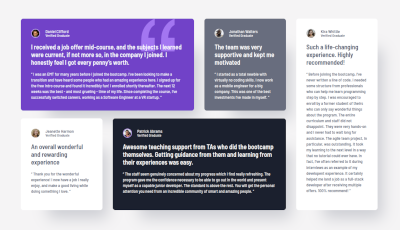

# Frontend Mentor - Testimonials grid section solution

This is a solution to the [Testimonials grid section challenge on Frontend Mentor](https://www.frontendmentor.io/challenges/testimonials-grid-section-Nnw6J7Un7). Frontend Mentor challenges help you improve your coding skills by building realistic projects. 

## Table of contents

- [Overview](#overview)
  - [The challenge](#the-challenge)
  - [Screenshot](#screenshot)
  - [Links](#links)
- [My process](#my-process)
  - [Built with](#built-with)
  - [What I learned](#what-i-learned)
  - [Continued development](#continued-development)
  - [Useful resources](#useful-resources)
- [Author](#author)
- [Acknowledgments](#acknowledgments)

## Overview

### The challenge

Users should be able to:

- View the optimal layout for the site depending on their device's screen size

### Screenshot



### Links

- Solution URL: [View code](https://github.com/marefpceo/fem-testimonials-grid)
- Live Site URL: [Live view](https://marefpceo.github.io/fem-testimonials-grid)

## My process

### Built with

- Semantic HTML5 markup
- CSS custom properties
- Flexbox
- CSS Grid
- Mobile-first workflow

### What I learned
This project I continued learning responsive layout techniques and focus more on semantics and accessibility. Using a combination of Flexbox and CSS Grid, it helped me reduce code while controlling the layout to achieve the desired look. 

Flexbox was used on the ```.card-grid``` to control the flow for the mobile view. For the tablet and desktop views, the display was changed to CSS Grid. Using CSS Grid for tablet and desktop allows for a smooth transition between views, and with the help of ```grid-template-area```, arranging the card order was effortless.

Below is how ```grid-template-area``` template was used to arrange the cards based on the breakpoints for tablet and desktop, respectively:

```css
@media (min-width: 48rem) {
    max-width: 40.4375rem;
    display: grid;
    grid-template-columns: repeat(2, 1fr);
    grid-template-rows: repeat(4, 1fr);
    grid-template-areas: 
      "card-1 card-1"
      "card-2 card-3"
      "card-4 card-4"
      "card-5 card-5"
      ;
  }

  @media (min-width: 90rem) {
    max-width: 69.625rem;
    grid-template-columns: repeat(4, 1fr);
    grid-template-rows: repeat(2, 1fr);
    row-gap: var(--spacing-300);
    grid-template-areas: 
      "card-1 card-1 card-2 card-5"
      "card-3 card-4 card-4 card-5"
    ;
  }
```

Semantics and accessibility was not at the forefront of this lesson, but it is still an important and an area that is overlooked at times. Biggest accessibility lesson learned here was the proper way to visually hide an ```<h1>``` element, but make it available for screen readers. This was done with the help and guidance of the *Accessibility Developer Guide (ADG)*. The following is how it was achieved: 

```css
.sr-only {
  position: absolute;
  left: -625rem;
  top: auto;
  width: 0.0625rem;
  height: 0.0625rem;
  overflow: hidden;
}
```
The ```.sr-only``` class positions the element far left of the center view. This makes sure that it does not come into view, but still meets SEO and accessibility needs. 

### Continued development
I will continue to build on the foundational fundamentals of responsive design and accessibility. I will do so by continuing to code and creating ways to incorporate checks into my overall workflow. 

### Useful resources

- [MDN Web Docs](https://developer.mozilla.org/en-US/) - This site helps as a desk reference for topics that are not frequently used and to make sure best practices are followed.
- [Accessibility Developer Guide](https://www.accessibility-developer-guide.com/introduction/) - This site is a comprehensive resource guide to utilizing accessibility.

## Author

- Website - [Lamar S.](https://www.lamar-stevens.com)
- Frontend Mentor - [@marefpceo](https://www.frontendmentor.io/profile/marefpceo)
- Twitter - [@stevens14704](https://www.twitter.com/stevens14704)
